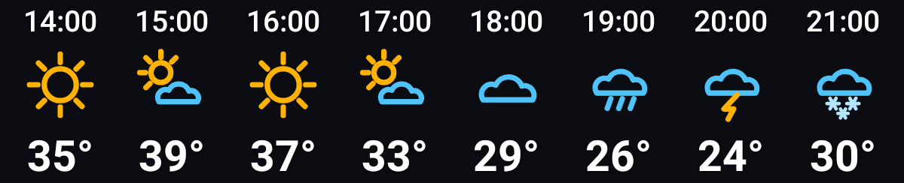
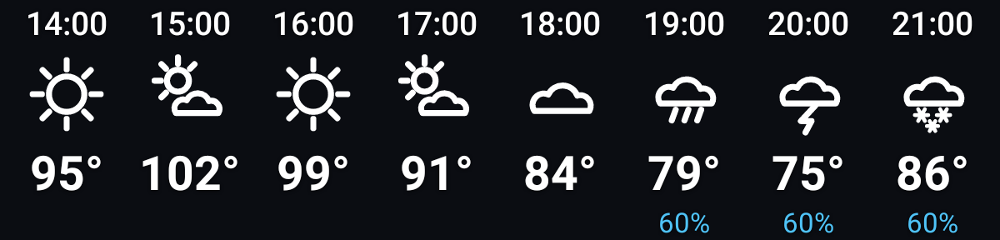

# Hairline

An Android home screen widget: hourly forecast drawn in thin lines, transparent background, tap to
open Windy. Built to replace Ventusky's widget after its price went up 4×, and to sit alongside a
line-art icon pack instead of fighting it.



Same widget with white icons, °F and rain probability turned on:



Both images are produced by the test suite — they are the real `RemoteViews`, inflated and drawn,
not mockups.

## What it does

- Hourly columns: time, weather icon, temperature. Optionally rain probability underneath.
- Column count follows the widget's width (3–12), or you can pin it.
- Transparent background, text shadows so it stays readable on a light wallpaper.
- Tapping it opens Windy. If Windy isn't installed it falls back to `windy.com` in the browser;
  Ventusky, browser-only and "do nothing" are also options.
- Location follows the device, or you can pin a city by name.
- °C or °F, colour icons or white ones.

## Install

Sideload the APK:

```sh
adb install -r app-debug.apk
```

Or build it yourself (needs a JDK 17+ and the Android SDK, `sdk.dir` in `local.properties`):

```sh
./gradlew assembleDebug      # app/build/outputs/apk/debug/app-debug.apk
./gradlew testDebugUnitTest  # also writes app/build/outputs/widget-preview/*.png
```

Then long-press the home screen → Widgets → Hairline, and drop it in. The setup screen opens on
placement; long-press the widget later to get back to it, or open the Hairline app icon.

Grant the location permission when asked. Without it the widget falls back to the last place it
knew about, or to whatever city you pinned by hand.

## How it works

- **Data**: [Open-Meteo](https://open-meteo.com) — free, no API key, no account. One request per
  refresh returns 48 hours of temperature, WMO weather code, day/night flag and rain probability.
  City search uses their geocoding endpoint.
- **Refresh**: WorkManager pulls new numbers every 30 minutes, only when there's a network, with
  linear backoff on failure. A separate inexact hourly alarm repaints from cache so the columns
  roll over on the hour even when Doze defers the fetch. The last response is cached in
  `SharedPreferences`, so a widget redraw never waits on the network.
- **Icons**: hand-built `VectorDrawable`s, one path per stroke, generated by
  `tools/gen_weather_icons.py`. Edit the geometry there and re-run it — don't edit the XML.
- **Dependencies**: `core-ktx`, `appcompat`, `work-runtime-ktx`. No Play Services, no HTTP library,
  no Compose. Location comes from the platform `LocationManager`'s last known fix, which is more
  than accurate enough for a forecast.

## Layout of the code

| File | Does |
| --- | --- |
| `WeatherWidgetProvider.kt` | Widget lifecycle: placement, resize, hourly repaint broadcast. |
| `WidgetRenderer.kt` | Builds the `RemoteViews` — columns, icons, tap target. |
| `WeatherApi.kt` | Open-Meteo forecast + geocoding, `HttpURLConnection` and `org.json`. |
| `RefreshWorker.kt` | The background fetch. |
| `Scheduler.kt` | WorkManager job + hourly alarm. |
| `LocationResolver.kt` | Manual place → device fix → last known place. |
| `ConfigActivity.kt` | Setup screen, doubles as the app's only activity. |
| `Prefs.kt` / `Forecast.kt` | Settings and the cached forecast, serialised by hand. |
| `tools/gen_weather_icons.py` | Generates the 12 weather icons. |

## Tweaking the look

- Colours live in `app/src/main/res/values/colors.xml` (`widget_text`, `widget_precip`) and at the
  top of `tools/gen_weather_icons.py` (`SUN`, `CLOUD`, `MOON`, …).
- Type sizes and icon size are in `app/src/main/res/layout/widget_hour.xml`.
- Stroke weight is `SW` in the icon generator — everything is drawn at 24×24 with round caps.

## Limits worth knowing

- Weather codes are WMO's, so "partly cloudy" is one bucket, not five. The icon set mirrors that.
- The widget shows the forecast location's local time, which only differs from your phone's clock
  if you pinned a city in another timezone.
- 30-minute refresh is a battery/freshness compromise; Android won't run periodic work more often
  than every 15 minutes anyway.
